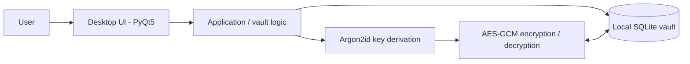

# Syberlock

**Offline-first desktop password manager | Personal software engineering project**

> **Development status: Work in progress.** Syberlock has not completed an independent security review and is **not recommended for storing real or irreplaceable credentials** at this stage.

Syberlock is a personal project focused on building a local-first password manager for desktop systems, with an emphasis on authenticated encryption, usability, and practical security engineering.

The long-term goal is a commercial application for macOS and Windows. This **public repository documents the design and development process**; the application source code is kept private and is not included in this repository.

## Project overview

- **Platform:** Windows and macOS (desktop)
- **Language / UI:** Python, PyQt5
- **Local persistence:** SQLite
- **Cryptographic design:** Argon2id for master-password-based key derivation; AES-GCM for authenticated encryption
- **Architecture:** local vault, without a required cloud backend
- **In exploration:** secure pairing and data transfer between authorized devices

The cryptographic choices below describe the **current design**, not an independently verified security guarantee.

## Architecture at a glance

The user enters a master password to unlock the local vault. The intended design derives an encryption key using Argon2id, then uses AES-GCM to protect sensitive entries before persistence. Database records and key-handling behavior must be verified in a dedicated code review.

See [Architecture](docs/ARCHITECTURE.md) for design decisions, trust boundaries, and assumptions.

## Cryptographic design

| Component | Selected design | Rationale |
| --- | --- | --- |
| Password-based KDF | Argon2id | Designed to increase the cost of offline password guessing |
| KDF parameters (current target) | memory 64 MiB, iterations 3, parallelism 1 | Starting configuration, to be benchmarked on target devices |
| Salt | 16 random bytes per vault | Prevents identical passwords from deriving identical keys across different salts |
| Encryption | AES-GCM | Provides confidentiality and authentication when implemented correctly |
| Derived key | 32 bytes | 256-bit key material for the chosen AES-GCM design |
| Storage | SQLite, locally | Keeps the primary vault on the user's device |

**Important:** AES-GCM requires a unique nonce for every encryption under the same key. Key management, nonce generation, associated data, password handling, storage encoding, and error paths must be tested and reviewed before release. A cryptographic algorithm alone does not make an application secure.

## Development status

| Area | Status |
| --- | --- |
| Desktop UI and basic vault workflows | Prototype / active development |
| Local database and cryptographic integration | Implementation under verification |
| Multi-device pairing and transfer | Experimental |
| Encrypted backup and recovery strategy | Not finalized |
| Independent security assessment | Not completed |
| Public store release | Not released |

These statuses describe the workstream, not a claim of production readiness.

## Roadmap

1. Stabilize credential management and local vault data handling.
2. Add automated tests for key derivation, encryption/decryption, tampering, and storage migrations.
3. Define and validate a secure device-pairing and transfer protocol.
4. Design encrypted backup, recovery, and version migration workflows.
5. Perform dependency review, threat modeling, and an independent security assessment.
6. Package, sign, and release supported desktop builds **only after** security and reliability checks.

See the [Roadmap](docs/ROADMAP.md) and [Security policy](SECURITY.md).

## Why is the source private?

Syberlock is intended to become a commercial product. This public repository provides an overview of the technical approach without publishing the proprietary implementation.

**This repository does not contain the application's full source code.** Public visibility is not an open-source license. No permission to reuse proprietary code is implied.

For technical interviews, a private code walkthrough or access to a suitably sanitized portion of the implementation can be arranged at the author's discretion.

## Security and responsible disclosure

**Do not use this development-stage application to store real passwords.** If you would like to review design assumptions or report a potential vulnerability, read [SECURITY.md](SECURITY.md). Do not post credentials, private vaults, keys, or exploit details in public issues.

## Disclaimer

This is a learning and product-development project, not a certification, audit report, or guarantee of security. Implementation details may change as testing and independent review progress.