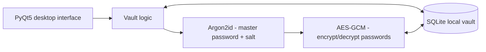

# Syberlock

**Offline-first desktop password manager | Personal project | Python · PyQt5 · SQLite**

> **Status:** Desktop prototype in development. Not independently security-reviewed; do not use it to store real passwords yet.

Syberlock is a desktop password manager I am building to store credentials locally, without relying on a cloud server. The project combines a PyQt5 interface, a SQLite database, and password-based encryption.

The application source remains private because I plan to develop Syberlock into a commercial product. This public repository documents the architecture, technical decisions, and development progress.

## What the prototype does

- Lets the user create and unlock a local vault using a master password.
- Displays saved credentials and supports adding, editing, deleting, and searching entries.
- Derives a 32-byte encryption key from the master password and a per-vault salt using **Argon2id**.
- Encrypts stored **passwords** using **AES-GCM**. Service names and usernames are currently stored in plaintext, so they are **not encrypted fields**.
- Stores credentials and the information needed for decryption locally in **SQLite**.

## How encryption works

1. When a vault is created, Syberlock generates a **16-byte random salt** and stores the salt and Argon2id settings in the local database.
2. When the user unlocks the vault, **Argon2id** derives a key from the entered master password and the saved salt.
3. When a password is added or edited, **AES-GCM** encrypts it using that key.
4. Each encryption generates a new **12-byte nonce with `os.urandom(12)`**. The nonce is stored in a separate SQLite column next to the encrypted password. The encrypted value includes the GCM authentication tag.
5. To show a stored password, the application reads the ciphertext and its nonce, then decrypts it with the derived key.

Using a different salt for each vault means the **same master password produces different derived keys across vaults**, making reusable precomputed password-cracking tables ineffective across those vaults.

**Argon2id settings in the current implementation:** 64 MiB memory, 3 iterations, parallelism 1, 32-byte derived key.

## Architecture

For the data flow and storage decisions, see [Architecture](docs/ARCHITECTURE.md).

## What's next

- Automated tests for encryption, authentication failures, database operations, and password handling.
- A separate security review before distributing the app for real-world password storage.
- Secure pairing and vault transfer between authorized devices.
- Backup and recovery, packaging, and Windows/macOS distribution.

See the [roadmap](docs/ROADMAP.md) and [security policy](SECURITY.md) for details.

## Source code and interviews

The source code is **private**, not open source. I can discuss the design and demonstrate the implementation in a technical interview without exposing credentials or private vault data.
