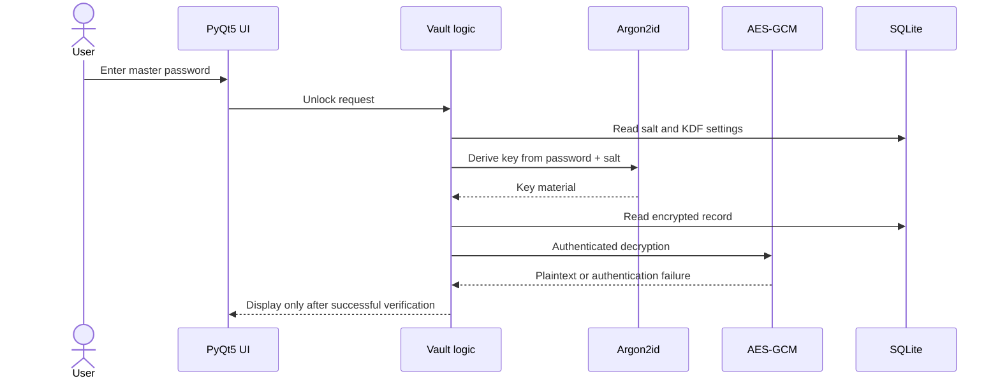

# Architecture and security design

> Design documentation for a work-in-progress prototype. Details must be compared with the actual implementation before a release.

## Scope

Syberlock is a Python desktop application with a PyQt5 interface and a SQLite-backed local vault. A cloud service is not required for ordinary local operation.

## Components

1. **Desktop interface:** master-password entry, vault browsing and credential operations.
2. **Application layer:** input validation, vault lifecycle, credential CRUD, lock/unlock behavior.
3. **Key derivation:** Argon2id derives key material from the master password and per-vault random salt.
4. **Authenticated encryption:** AES-GCM protects sensitive fields; encryption requires a fresh, unique nonce for every operation under the same key.
5. **Local storage:** SQLite holds vault settings and encrypted credential records.
6. **Future pairing module:** discovery/authorization/data transfer among devices is **experimental**, and must undergo its own protocol review.

## Conceptual flow

This diagram is conceptual; it does not verify the source's behavior.

## KDF parameters (design target)

- Algorithm: **Argon2id**
- Memory: **64 MiB** (`m=65536 KiB`)
- Iterations: **3**
- Parallelism: **1**
- Output length: **32 bytes**
- Random salt length: **16 bytes**

Parameters must be benchmarked for supported platforms and re-evaluated over time. Salt and KDF parameters are not secret, but they require integrity-aware handling.

## Security boundaries and assumptions

- The vault is expected to protect stored secrets against **offline access to the encrypted database**, given a strong master password and correctly implemented cryptography.
- The design does **not** promise protection when the operating system is compromised, malware has access to an unlocked process, or the user divulges the master password.
- A password manager cannot eliminate risks from clipboard history, screenshots, swap files, backups, crash dumps, or process memory.
- Authentication failure in AES-GCM must never be interpreted as success.
- Error messages and logs must not contain secrets.
- The future device pairing feature creates a new trust boundary. Authentication, key agreement, replay protection, device revocation, and network transport must be reviewed separately.
- No account-recovery claim is made until a safe recovery design is implemented and tested.

## Items requiring verification against source

- Unique nonces under each encryption key, including across restarts and synchronization.
- Correct AES-GCM nonce/ciphertext/tag serialization and authentication handling.
- Proper key lifecycle and zeroization limits in Python runtimes.
- No plaintext secrets in SQLite tables, logs, temporary files, or exception traces.
- Database schema migration and corruption handling.
- End-to-end behavior when the user enters an incorrect master password.
- Behavior under tampered ciphertext, salt, or key-derivation settings.
- Dependency pinning, reproducible builds, and software signing.

## Why document the design?

The aim is to make decisions, assumptions, and unresolved issues inspectable without asserting that the product is already secure.