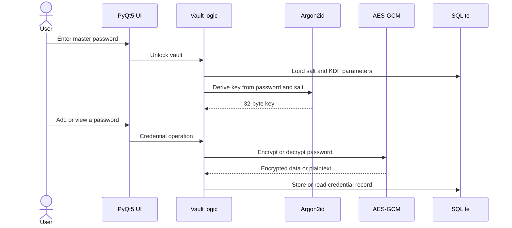

# Syberlock architecture

Syberlock is a local-first desktop password manager built in Python with a PyQt5 interface and SQLite storage. It does not require a cloud backend for local vault operations.

## Main components

| Component | Responsibility |
| --- | --- |
| PyQt5 interface | Master-password screen, credential list, search, and add/edit/delete actions |
| Vault logic | Handles unlocking and credential operations |
| Argon2id | Derives a 32-byte encryption key from the master password and vault salt |
| AES-GCM | Encrypts and authenticates stored passwords |
| SQLite | Stores encrypted passwords, their nonces, service names, usernames, and vault configuration |

## Data flow

## Key derivation and salt

When creating a vault, the application generates a random **16-byte salt**, which is stored with the vault configuration. Argon2id takes the master password and salt to derive the AES-GCM key.

Current parameters:

- **Algorithm:** Argon2id
- **Memory cost:** 64 MiB (`m=65536 KiB`)
- **Iterations:** 3
- **Parallelism:** 1
- **Salt:** 16 random bytes
- **Derived key:** 32 bytes

The same master password produces different keys in different vaults when those vaults use different salts. This also prevents reuse of a single precomputed password-cracking table across those salts.

## AES-GCM and nonce handling

The encryption code generates a **fresh 12-byte nonce using `os.urandom(12)` for each encryption**.

- The nonce is stored separately alongside the ciphertext in SQLite.
- The AES-GCM output includes an authentication tag.
- Decryption uses the same key and the saved nonce to recover the password and check its authenticity.

AES-GCM needs nonce uniqueness for any given key. With randomly generated 96-bit nonces, collision risk increases with the number of encryptions; the implementation needs to respect applicable per-key usage limits. This mechanism will be covered by automated tests and a security review.

## What is encrypted?

**Currently encrypted:** the password field.

**Currently stored in plaintext:** service names and usernames. SQLite database encryption is not provided by simply encrypting the password field.

This distinction matters because someone who obtains the database may still learn which services and usernames are recorded even without knowing the master password.

## Work still to do

- Add automated tests for wrong master passwords, corrupted or modified ciphertext, and database errors.
- Verify credential lifecycle, key handling, and nonce behavior across restarts.
- Finalize encrypted backup and recovery.
- Design, implement, and test secure device pairing and data transfer.
- Arrange an independent security review before production release.
